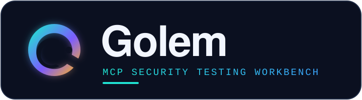
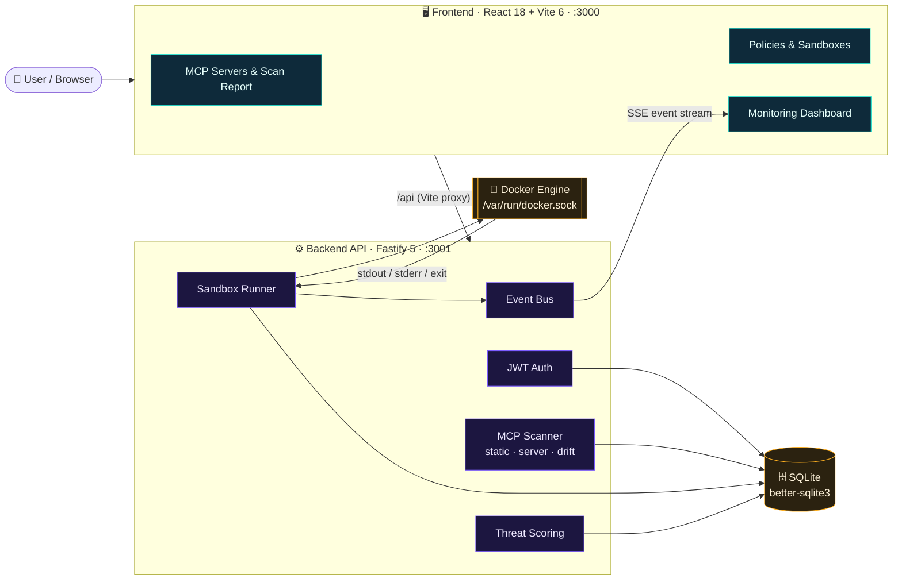
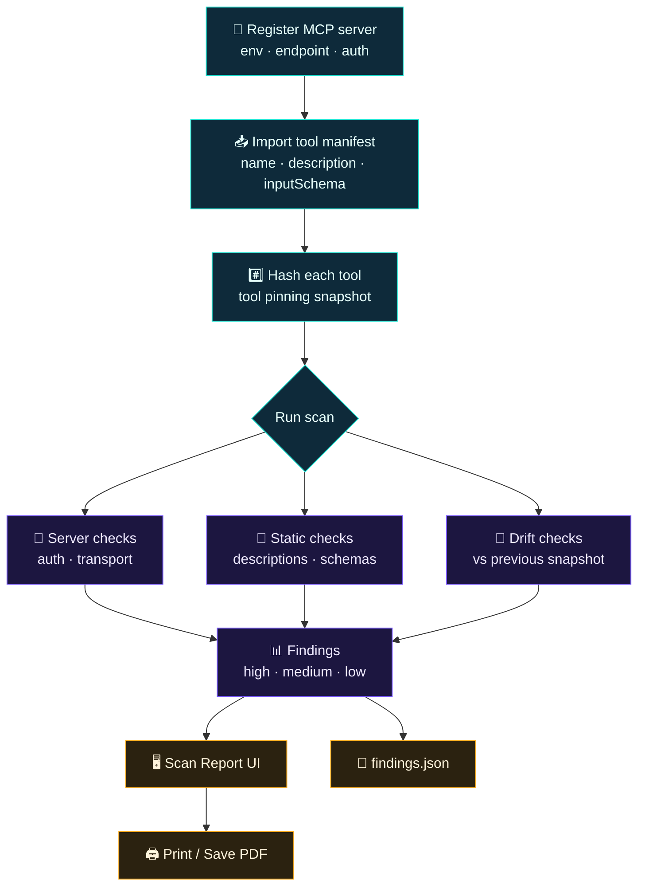
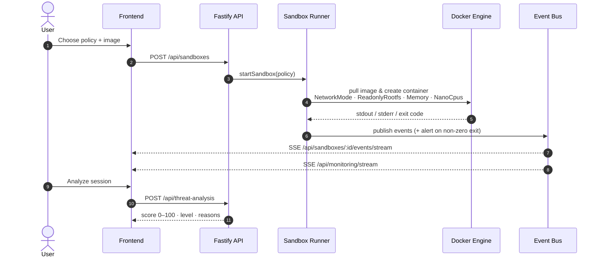

<a id="readme-top"></a>

<div align="center">



### Local-first MCP Security Testing Workbench

Register MCP servers · import tool manifests · run static + drift scans · export findings (JSON / PDF)

<p>
  
  <a href="LICENSE"></a>
  <a href="CONTRIBUTING.md"></a>
  
</p>

<p>
  
  
  
  
  
  
  
</p>

<a href="#-quick-start"><b>Quick start</b></a> ·
<a href="#-architecture"><b>Architecture</b></a> ·
<a href="#-implemented-security-checks"><b>Security checks</b></a> ·
<a href="#-api-reference"><b>API</b></a> ·
<a href="SECURITY.md"><b>Security notes</b></a>

</div>

---

## 📑 Table of Contents

- [Overview](#-overview)
- [Features](#-features)
- [Tech Stack](#-tech-stack)
- [Architecture](#-architecture)
- [Quick Start](#-quick-start)
- [Usage Walkthrough](#-usage-walkthrough)
- [Implemented Security Checks](#-implemented-security-checks)
- [Sandbox Policies & Threat Scoring](#-sandbox-policies--threat-scoring)
- [Configuration](#-configuration)
- [API Reference](#-api-reference)
- [Project Structure](#-project-structure)
- [Scripts & Testing](#-scripts--testing)
- [Roadmap](#-roadmap)
- [Contributing](#-contributing)
- [FAQ & Troubleshooting](#-faq--troubleshooting)
- [Security, Scope & License](#-security-scope--license)

---

## 🧭 Overview

**Golem** helps you understand what your **MCP (Model Context Protocol) servers** can do, find risky tool designs early, detect drift over time, and generate shareable evidence — **`findings.json` + a printable PDF report** — without a heavy enterprise setup.

> If you're building agentic workflows, the easiest time to catch MCP risk is **before** the first production incident. Golem is designed to make that practical.

**Why it matters**

- 🔍 **Visibility** — an inventory of MCP servers and the exact tools/schemas they expose.
- 🧱 **Explainable checks** — deterministic rules (no ML, no proxy) that are easy to reason about and reproduce.
- 📌 **Tool pinning** — hash-based baselines flag silently added, removed or modified tools.
- 📄 **Evidence** — reports you can hand to a reviewer or feed into a CI pipeline.

<p align="right">(<a href="#readme-top">back to top</a>)</p>

---

## ✨ Features

<table>
<tr>
<td width="50%" valign="top">

### 🛡️ MCP Security Testing *(core)*

- **Server inventory** — register servers with environment (`local` / `dev` / `staging` / `prod`), endpoint and auth metadata.
- **Tool manifest import** — paste tool definitions in several common JSON shapes.
- **Static scans** — rule-based checks on server config, descriptions and input schemas.
- **Drift detection** — SHA-based tool pinning versus the previous scan.
- **Reports** — severity breakdown, recommendations, **Download `findings.json`**, **Print / Save PDF**.

</td>
<td width="50%" valign="top">

### 📦 Sandbox & Monitoring *(supporting)*

- **Policies** — network on/off, CPU, memory, read-only root FS, plus ready-made templates.
- **Sandboxes** — start/stop Docker-based sessions via `dockerode`.
- **Monitoring** — live event streaming over **SSE**, alerts and session history.
- **Threat analysis** — deterministic 0–100 risk score with human-readable reasons.
- **Auth** — local accounts with JWT sessions.

</td>
</tr>
</table>

<p align="right">(<a href="#readme-top">back to top</a>)</p>

---

## 🧰 Tech Stack

<div align="center">

| | Technology | Role |
|:-:|---|---|
|  | **TypeScript** | Language for frontend and backend |
|  | **Node.js ≥ 18** | Backend runtime (npm workspaces monorepo) |
|  | **Fastify 5** | HTTP API, `@fastify/jwt`, `@fastify/cors` |
|  | **React 18** | UI with React Router 6 |
|  | **Vite 6** | Frontend dev server, `/api` proxy and build |
|  | **SQLite** | Embedded storage via `better-sqlite3` |
|  | **Docker** | Sandbox runtime (`dockerode`) and Docker Compose dev stack |
|  | **CSS** | Custom styling (`styles.css`) |

</div>

<p align="right">(<a href="#readme-top">back to top</a>)</p>

---

## 🏗️ Architecture

### System overview



### MCP scan workflow



### Sandbox & monitoring flow



<p align="right">(<a href="#readme-top">back to top</a>)</p>

---

## 🚀 Quick Start

### Prerequisites

- **Node.js ≥ 18** and npm
- **Docker** (+ Docker Compose) — required for Option A and for sandbox execution

### Option A — Docker Compose *(recommended)*

```bash
# 1. Copy environment files
cp packages/backend/.env.example packages/backend/.env
cp packages/frontend/.env.example packages/frontend/.env

# 2. Set a strong JWT secret (min. 16 chars) in packages/backend/.env
#    JWT_SECRET=change-me-to-a-long-random-string

# 3. Build and start the stack
npm run dev
```

> ⚠️ `docker-compose.yml` sets its own `JWT_SECRET` for the backend container — change it there too before sharing the stack.

### Option B — Run frontend and backend separately

```bash
npm install

# Terminal 1
npm run dev:backend

# Terminal 2
npm run dev:frontend
```

### Open

| Service | URL |
|---|---|
| Frontend | http://localhost:3000 |
| Backend health | http://localhost:3001/health |

<p align="right">(<a href="#readme-top">back to top</a>)</p>

---

## 🧪 Usage Walkthrough

1. **Sign in** — open http://localhost:3000 and register a local account (JWT auth).
2. **Go to _MCP Testing_** → **Add MCP server**
   - *environment*: `local` / `dev` / `staging` / `prod`
   - *endpoint*: the URL or identifier you use for that server
   - *auth*: `none` / `token` (metadata used by the checks)
3. Click **Open**, paste your tool manifest JSON and click **Import**.
4. Click **Run scan** — you land on the **Scan Report**, where you can **Download findings.json** or **Print / Save PDF**.

### Tool manifest formats

Golem accepts several shapes so you can paste whatever you already have:

```jsonc
// 1. tools wrapper
{ "tools": [ { "name": "x", "description": "...", "inputSchema": { "type": "object" } } ] }

// 2. capabilities wrapper
{ "capabilities": { "tools": [ ... ] } }

// 3. server wrapper
{ "server": { "tools": [ ... ] } }

// 4. bare array
[ { "name": "x", "description": "...", "inputSchema": { "type": "object" } } ]
```

<details>
<summary><b>Example manifest that triggers several findings</b></summary>

```json
{
  "tools": [
    {
      "name": "fetch_url",
      "description": "Fetch any http resource",
      "inputSchema": {
        "type": "object",
        "properties": { "url": { "type": "string" }, "apiKey": { "type": "string" } }
      }
    },
    {
      "name": "run",
      "description": "Execute a shell command",
      "inputSchema": { "type": "object", "properties": { "command": { "type": "string" } } }
    }
  ]
}
```

Expected: *potential SSRF*, *secret-like parameter*, *dangerous parameters*, *high-risk description* and *command injection* findings.

</details>

<p align="right">(<a href="#readme-top">back to top</a>)</p>

---

## 🔎 Implemented Security Checks

Every check is a deterministic rule in [`packages/backend/src/mcp/scanner.ts`](packages/backend/src/mcp/scanner.ts).

| Group | Check | Severity | Triggers when |
|---|---|:-:|---|
| **Server** | Missing authentication | 🔴 High | Non-local environment with `auth = none` |
| **Server** | Insecure transport (HTTP) | 🟠 Medium | Non-local, non-loopback endpoint uses `http://` |
| **Metadata** | Missing tool description | 🟢 Low | Description is empty |
| **Tool risk** | High-risk description | 🔴 High / 🟠 Medium | Mentions `admin`, `root`, `shell`, `execute` (high) or `filesystem`, `delete`, `curl`, `wget` (medium) |
| **Schema** | Dangerous parameters | 🟠 Medium | Schema contains `path`, `filepath`, `command`, `cmd`, `url`, `uri`, `host` |
| **Secrets** | Secret-like parameters | 🔴 High | Properties such as `token`, `apiKey`, `password`, `credential`, `private_key` |
| **Input validation** | Unbounded object input | 🟠 Medium | Object schema with no properties and `additionalProperties` allowed |
| **SSRF** | URL/host param without constraints | 🔴 High | Network-like tool with URL/host params lacking `enum` / `pattern` / `format` / … |
| **Command exec** | Command param without constraints | 🔴 High | `command` / `cmd` / `shell` params lacking constraints |
| **Drift** | Tool added | 🟠 Medium | New tool vs. previous snapshot |
| **Drift** | Tool removed | 🟠 Medium | Tool missing vs. previous snapshot |
| **Drift** | Tool definition changed | 🔴 High | Tool hash differs from pinned baseline |

Each finding includes a **category**, **evidence** and a concrete **recommendation**.

<p align="right">(<a href="#readme-top">back to top</a>)</p>

---

## 📦 Sandbox Policies & Threat Scoring

### Built-in policy templates

| Template | Network | Memory | CPU | Read-only root FS |
|---|:-:|:-:|:-:|:-:|
| Default (No Network) | ❌ | 256 MB | 0.5 | ✅ |
| Network Allowed | ✅ | 512 MB | 1 | ✅ |
| Locked Down (Tiny) | ❌ | 128 MB | 0.25 | ✅ |
| Compute (No Network) | ❌ | 2048 MB | 2 | ✅ |
| Install/Build (Network + Writable) | ✅ | 1024 MB | 2 | ❌ |
| Debug (Network + Writable, Small) | ✅ | 512 MB | 1 | ❌ |

### Threat score signals *(0–100)*

| Signal | Points |
|---|:-:|
| Runtime errors | +30, +10 per extra error (max 60) |
| High stderr volume (≥ 10 lines) | +10 |
| Network enabled by policy | +10 |
| Long-running session (≥ 10 min) | +10 |
| High activity volume (≥ 100 events) | +10 |

**Level:** `high` ≥ 60 · `medium` ≥ 30 · otherwise `low`.

<p align="right">(<a href="#readme-top">back to top</a>)</p>

---

## ⚙️ Configuration

### Backend — `packages/backend/.env`

Validated at startup with Joi ([`src/config/env.ts`](packages/backend/src/config/env.ts)).

| Variable | Default | Description |
|---|---|---|
| `PORT` | `3001` | API port |
| `JWT_SECRET` | — *(required, ≥ 16 chars)* | Secret used to sign JWTs |
| `DATABASE_PATH` | `./data/app.db` | SQLite database file |
| `DOCKER_SOCKET` | `/var/run/docker.sock` | Docker socket used for sandboxes |
| `NODE_ENV` | `development` | `development` · `test` · `production` |

### Frontend — `packages/frontend/.env`

| Variable | Default | Description |
|---|---|---|
| `VITE_API_URL` | `http://localhost:3001` | Optional API base URL; the app also works through the proxy when unset |
| `VITE_PROXY_TARGET` | `http://localhost:3001` | Target for the Vite `/api` dev proxy (`http://backend:3001` in Compose) |

<p align="right">(<a href="#readme-top">back to top</a>)</p>

---

## 📡 API Reference

All endpoints except auth and `/health` require a `Bearer` JWT.

<details open>
<summary><b>Auth & health</b></summary>

| Method | Endpoint | Description |
|:-:|---|---|
| `GET` | `/health` | Liveness check |
| `POST` | `/api/auth/register` | Create a local account |
| `POST` | `/api/auth/login` | Obtain a JWT |

</details>

<details open>
<summary><b>MCP testing</b></summary>

| Method | Endpoint | Description |
|:-:|---|---|
| `GET` | `/api/mcp/servers` | List registered servers |
| `POST` | `/api/mcp/servers` | Register a server |
| `GET` | `/api/mcp/servers/:id` | Server detail with tools |
| `POST` | `/api/mcp/servers/:id/tools/import` | Import a tool manifest |
| `POST` | `/api/mcp/servers/:id/scan` | Run server, static and drift checks |
| `GET` | `/api/mcp/scans` | List scans |
| `GET` | `/api/mcp/scans/:id` | Scan report |
| `GET` | `/api/mcp/scans/:id/findings.json` | Download findings |
| `GET` | `/api/mcp/overview` | Dashboard overview |

</details>

<details>
<summary><b>Policies & sandboxes</b></summary>

| Method | Endpoint | Description |
|:-:|---|---|
| `GET` | `/api/policy-templates` | Built-in templates |
| `GET` | `/api/policies` | List your policies |
| `POST` | `/api/policies` | Create a policy |
| `GET` | `/api/sandboxes` | List sandboxes |
| `POST` | `/api/sandboxes` | Start a sandbox |
| `GET` | `/api/sandboxes/:id` | Sandbox detail |
| `POST` | `/api/sandboxes/:id/stop` | Stop a sandbox |
| `GET` | `/api/sandboxes/:id/events` | Event history |
| `GET` | `/api/sandboxes/:id/events/stream` | Live events (SSE) |

</details>

<details>
<summary><b>Monitoring & threat analysis</b></summary>

| Method | Endpoint | Description |
|:-:|---|---|
| `GET` | `/api/monitoring/sessions` | Active sessions |
| `GET` | `/api/monitoring/history` | Session history |
| `GET` | `/api/monitoring/alerts` | Alerts |
| `GET` | `/api/monitoring/stream` | Global live stream (SSE) |
| `POST` | `/api/threat-analysis` | Score a sandbox session |

</details>

<p align="right">(<a href="#readme-top">back to top</a>)</p>

---

## 🗂️ Project Structure

```text
Golem-MCP-secure/
├── assets/
│   └── golem-wordmark.svg
├── docker-compose.yml          # backend + frontend dev stack
├── package.json                # npm workspaces root
├── SECURITY.md
├── CONTRIBUTING.md
├── CODE_OF_CONDUCT.md
├── LICENSE                     # dual-license notice
├── LICENSE-APACHE
├── LICENSE-GPL
├── .github/ISSUE_TEMPLATE/     # bug, feature, scanner-finding templates
└── packages/
    ├── backend/                # Fastify + TypeScript API
    │   ├── Dockerfile
    │   ├── src/
    │   │   ├── server.ts       # entry point
    │   │   ├── app.ts          # Fastify app, plugins, /health
    │   │   ├── routes.ts       # all /api routes
    │   │   ├── config/env.ts   # Joi-validated environment
    │   │   ├── db/             # SQLite: users, policies, sandboxes, events, mcp
    │   │   ├── mcp/scanner.ts  # server, static and drift checks
    │   │   ├── sandbox/runner.ts  # Docker sandbox runner
    │   │   ├── events/bus.ts   # in-memory pub/sub for SSE
    │   │   ├── threat/scoring.ts  # deterministic risk scoring
    │   │   └── security/password.ts
    │   └── tests/              # node:test suites
    └── frontend/               # React + Vite + TypeScript UI
        ├── Dockerfile
        ├── vite.config.ts      # /api proxy
        └── src/
            ├── pages/          # McpServers, McpServerDetail, McpScanReport,
            │                   # Policies, Sandboxes, SandboxDetail, Monitoring,
            │                   # Login, Register
            ├── components/     # Layout, GolemLogo, AuthHeroArt
            ├── services/api.ts
            └── auth.tsx
```

<p align="right">(<a href="#readme-top">back to top</a>)</p>

---

## 🛠️ Scripts & Testing

| Command | What it does |
|---|---|
| `npm run dev` | `docker compose up --build` |
| `npm run dev:backend` | Backend in watch mode (`tsx watch`) |
| `npm run dev:frontend` | Vite dev server on port 3000 |
| `npm run build` | Build all workspaces |
| `npm run lint` / `npm run format` | ESLint / Prettier |
| `npm test` | Build and run backend tests with `node --test` |

Backend test suites: `mcp`, `monitoring`, `password`, `runner-alert`, `scoring`.

<p align="right">(<a href="#readme-top">back to top</a>)</p>

---

## 🗺️ Roadmap

*Proposed next steps, kept within Golem's local-first scope:*

- [x] MCP server inventory, manifest import and static checks
- [x] Drift detection with tool pinning
- [x] Scan report with `findings.json` and PDF export
- [x] Docker sandboxes, SSE monitoring and threat scoring
- [ ] CLI / CI mode that fails a build on high-severity findings
- [ ] Fetch tool manifests directly from a running MCP server
- [ ] Custom rule configuration (allowlists, severity overrides)
- [ ] SARIF export for code-scanning integrations
- [ ] GitHub Actions workflow with build and test badges

<p align="right">(<a href="#readme-top">back to top</a>)</p>

---

## 🤝 Contributing

Contributions are welcome! Please read the [**Contributing Guide**](CONTRIBUTING.md) for setup, code style and how to add a scanner rule, and follow our [**Code of Conduct**](CODE_OF_CONDUCT.md).

1. Fork the repository and create a branch: `git checkout -b feat/my-change`
2. Install dependencies: `npm install`
3. Make your change and run `npm run lint` and `npm test`
4. Commit with a clear message and open a Pull Request describing **what** and **why**

Found a bug, have an idea, or spotted a scanner false positive? [**Open an issue**](https://github.com/sriroopchakraborty1991-lang/Golem-MCP-secure/issues/new/choose) using one of the templates.

<p align="right">(<a href="#readme-top">back to top</a>)</p>

---

## ❓ FAQ & Troubleshooting

<details>
<summary><b>The backend fails with <code>Invalid environment: "JWT_SECRET" ...</code></b></summary>

`JWT_SECRET` is required and must be at least 16 characters. Set it in `packages/backend/.env` (or in `docker-compose.yml` when using Compose).
</details>

<details>
<summary><b>Sandboxes don't start / Docker permission denied</b></summary>

The backend talks to Docker through `DOCKER_SOCKET` (default `/var/run/docker.sock`). Make sure Docker is running and your user (or the backend container) can access the socket. Compose mounts it automatically.
</details>

<details>
<summary><b>The frontend shows network errors on <code>/api</code></b></summary>

The Vite dev server proxies `/api` to `VITE_PROXY_TARGET` (default `http://localhost:3001`). Confirm the backend is running and the target is correct — in Compose it is `http://backend:3001`.
</details>

<details>
<summary><b>Port 3000 or 3001 is already in use</b></summary>

Stop the conflicting process, or change `PORT` for the backend and the `ports` mapping in `docker-compose.yml`.
</details>

<details>
<summary><b>Does Golem connect to my MCP server?</b></summary>

No. Scans run on the tool manifest you import, plus the server metadata you register. Nothing is proxied or intercepted.
</details>

<p align="right">(<a href="#readme-top">back to top</a>)</p>

---

## 🔐 Security, Scope & License

- Read the [**Security Notes**](SECURITY.md) before running Golem.
- Golem is an **MVP for local use** and for learning/testing workflows.
- It intentionally avoids enterprise features (SIEM connectors, runtime gateways, ML anomaly detection); production hardening is out of scope.
- **Do not** expose the backend publicly while the Docker socket is mounted.
- SSE uses a query-string token for simplicity — treat the UI as trusted/local.

### License

Copyright © 2026 Sriroop Chakraborty. Golem is **dual-licensed** — you may use it under either license, at your option:

- [Apache License 2.0](LICENSE-APACHE)
- [GNU General Public License v3.0](LICENSE-GPL)

See [LICENSE](LICENSE) for details. `SPDX-License-Identifier: Apache-2.0 OR GPL-3.0-only`

<div align="center">

---


<sub>Built for safer agentic workflows · catch MCP risk before production does.</sub>

</div>

<p align="right">(<a href="#readme-top">back to top</a>)</p>
